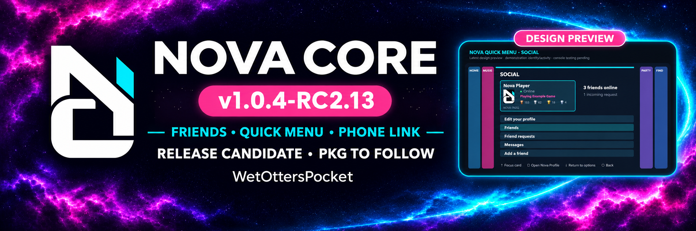
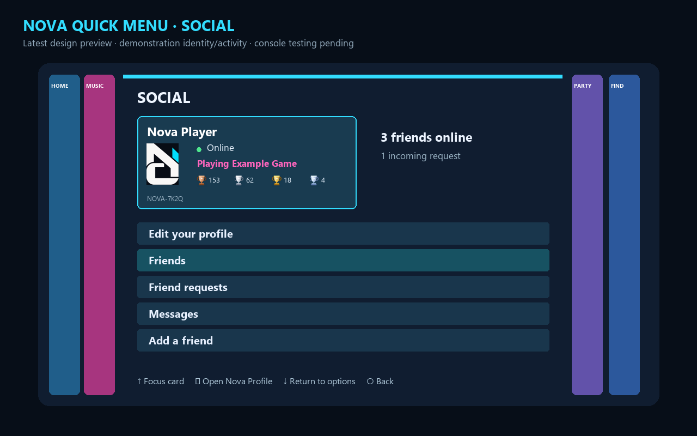

# NovaCore 🦦

A free, customisable PS4 dashboard by **WetOttersPocket**. Games, media, friends and tools together, with a **Quick Menu inside Nova, on the PS4 dashboard and over games**.

## 🌌 Latest: v1.0.4-RC2.13

**[Release notes](https://github.com/WetOttersPocket/NovaCore/releases/tag/v1.0.4-RC2.13)** · [Changelog](CHANGELOG.md) · [Known issues](KNOWN-ISSUES.md) · [Test checklist](docs/TESTING-RC2.13.md) · [Discord](https://discord.gg/cjgA8T94E)

📦 **[RC2.13 PKG and checksum are available in release Assets](https://github.com/WetOttersPocket/NovaCore/releases/tag/v1.0.4-RC2.13).**

**New Quick Menu input report:** menu navigation can also move the game/dashboard underneath. Avoid it during live gameplay pending confirmation. A separate RC2.14 focus fix candidate has passed host checks and still needs console testing; it is not in the RC2.13 download. [Previous RC2.1 downloads](https://github.com/WetOttersPocket/NovaCore/releases/tag/v1.0.4-RC2.1) remain available with their own limitations.

The latest candidate adds a more complete **QM Social gamercard, Friends/requests/messages, local MP3s and artwork, independent YouTube setup and real phone notifications**. Changes also address top-bar panels, unread markers, Back-button freezes, text sizing, Store redirects, streams and local MP4 input. **Current console playback problems are still being investigated**; built/tested does not mean confirmed on every console. See [known issues](KNOWN-ISSUES.md).

## 🎮 Quick Menu and return to Nova

- **Hold touchpad for about half a second** to open the Quick Menu.
- Choose **Return to Nova → ✕** to get back quickly from a game or Sony dashboard.
- A normal **PS tap still opens Sony's dashboard**.
- Control music, volume and favourite radio/local tracks while playing.
- **Social:** your gamercard, Friends, requests, messages and profile controls. Press **Up** from its first option to focus your card; **✕** opens Nova Profile and **Down** returns to options.
- New gamercard design: green **Online**, pink **Playing…** line and trophy pictures/counts. Activity is hidden for Appear offline or sharing-off.
- Sony top-bar Profile/Friends/Messages have **separate panels**, rather than opening the touchpad menu.

*Generated desktop design preview with demonstration data; actual PS4 appearance/behaviour still needs testing.*

## 📱 Phone Link, without Friends setup

YouTube uses its own automatic device setup; no Nova Online friend-code setup or Google sign-in is required. Open **Media → YouTube → Phone Link** and scan the QR to pair once.

Tap **Enable notifications** on the phone. iPhone users first add NovaCore to the Home Screen and open that icon. Notifications can then bring you back when the PS4 needs Phone Link or playback approval, even with the page closed, subject to phone settings. Tapping never approves playback automatically. Existing pairings are preserved; Test, Off and Unpair are available. Actual phone delivery still needs your permission/test step.

## 🎵 Music and NovaFlix

**Audio → Local files** scans HDD/USB MP3s, including the Nova music folder, with a 1,000-track limit. Embedded MP3 art and local film cover pictures are supported where available; originals stay unchanged. Radio, favourites, custom stations, queue and Quick Menu controls remain.

NovaFlix opens directly to its catalogue. The provided IPTV.org source is **live TV**, grouped by category, with supplied logos or a branded fallback. Your own legal sources, local/USB films and Jellyfin remain. Captures stays in its separate gallery. Geo/offline flags and actual failures are filtered where detected, but source availability varies.

**Local MP4 and live-stream playback remain under test.** The new local reader passed computer-side tests with a reported film's metadata and picture/audio samples; console success is not yet claimed. H.265/DRM/above-1080p are unsupported. [Full playback status](KNOWN-ISSUES.md).

## 🌈 Make it yours

Choose startup tab, layout, themes, colours, wallpapers, motion, tile sizing, name effects, sounds, music and dashboard glow. Nova Neon/Theme Studio, 13 Library layouts (including Cover Flow, Tabletop and Star Wars-style scrolling), plus optional Nova Series/Switch/Console Mix looks remain. Some layouts are still being polished.

| Area | What you can do |
|---|---|
| **Library** | Browse 13 layouts, including Cover Flow, Tabletop and scrolling Star Wars-style views. Import PS dashboard folders or create your own. L3 flips the case; R3 opens game actions. R3 + △ saves the filter and layout. |
| **Stores & transfers** | Use replaceable FPKGi-format sources, a Di Play store shortcut, the Homebrew catalogue, checked Homebrew downloads, transfer history and Nova update checks. Supply only sources you have permission to use; Nova does not supply pirated games or films. |
| **Media** | NovaFlix rows and featured rotation, your own films with generated posters, M3U/M3U8 playlists, stream URLs, Jellyfin, local/USB media, Nova Cast, captures and file browsing. |
| **Music** | World Radio, favourites, your own stations, MP3s, playback controls and a mini player. Quick Menu music continues over games and the PS dashboard. |
| **Nova Online** | Friend codes, presence, messages, group chat, voice, Nova Play rooms, compatible System Link and Discord linking/Rich Presence setup. Game and service compatibility varies; Nova Play is not universal matchmaking for every game. |
| **Your profile** | Per-user pictures from the bundle or USB, trophies with icons/dates, notifications, activity, achievements and Wrapped. Nova pictures do not replace Sony's system avatar. |
| **Tools** | GoldHEN hub, PS4 Care, files/packages, system controls, scene tools, retro arcade, news, save snapshots, recovery backup, log export and screen recording. Availability depends on the console and enabled services. |

Nova pictures/names are used by Nova and its dashboard integration. This is **not a PSN Online ID change**; system-profile picture writes remain disabled and Sony local-name writes are not included. Discord QR linking remains; the optional community-member feed is not enabled. Nova messages use the server, are not end-to-end encrypted and are retained there for up to 30 days.

## 🌍 Languages

English, Español, Français, Deutsch, Italiano and Português, plus System default under **Settings → System → Language**. Main tabs, settings, hints and greetings are translated; deeper pages and source content can remain English. Broader non-English hardware checks are pending.

## 📥 Install once the new PKG is attached

GoldHEN is required. Do not update firmware for Nova. The owner's established test setup is PS4 Slim/13.02/GoldHEN; other combinations need testing.

1. Get the named release's PKG and matching checksum from its Assets.
2. Install through your usual HEN Package Installer; keep the last working package/settings.
3. Open Nova manually once for component setup. After a clean launch, fully restart and enable HEN for the updated resident helper. Enable Nova AutoRun in your loader if requested.
4. Hold touchpad for Quick Menu; **Return to Nova → ✕** gets back from a game.

A brief black screen/notices/Sony dashboard can occur during the established startup flow. A lasting hang/crash is not normal; stop and report it. Do not delete saves, users or game databases for an update. An older package may not automatically downgrade a newer helper.

## 🧪 Testing and privacy

Test boot, internal/USB games, Quick Menu, requests/messages, top-bar panels, music, local/stream video and phone notifications. Include build/model/firmware/HEN, steps and exact error. Export relevant logs and redact secrets, private messages and pairing details. [Full checklist](docs/TESTING-RC2.13.md) · [Report an issue](https://github.com/WetOttersPocket/NovaCore/issues).

The application source stays **private** during this RC. This repository contains public documentation/previews, not private app/plugin source. Downloads remain free; no donation or Discord membership required. [Third-party credits](THIRD-PARTY-NOTICES.md).
