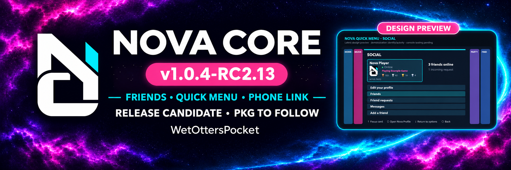
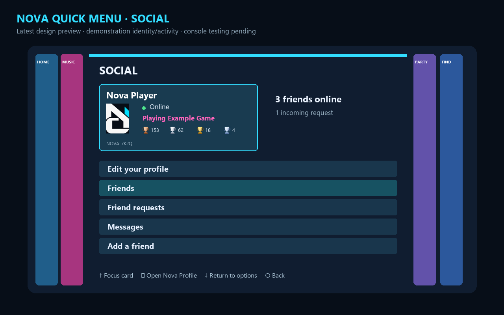
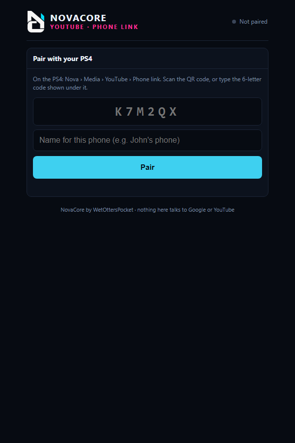

# 🌌 NovaCore v1.0.4-RC2.13

**Friends, a better Quick Menu, easier YouTube setup and phone notifications.** This brings together the work since the last public build, **RC2.1**, including the latest music, artwork and playback changes.

📦 **The PKG will be added here separately. There is no RC2.13 download attached yet.** This is a release candidate; the latest changes have passed build and computer-side checks, but still need testing on PS4. The pictures below are generated interface previews, except the Phone Link browser screenshot.

## 🎮 Your Quick Menu, wherever you play

Hold the **touchpad for about half a second** to open Nova Quick Menu inside Nova, on the PS4 dashboard or over a game. To return quickly, choose **Return to Nova** and press **✕**. A normal PS-button tap still opens Sony's dashboard.

- **Social stays in the Quick Menu:** your gamercard, Friends, incoming requests, messages, quick replies and profile options together.
- **Online and playing:** the gamercard shows a green light beside **Online**, with the current tracked game on a separate pink line. Appear offline uses grey and hides the game; turning off activity sharing also hides it.
- **Trophy pictures:** bronze, silver, gold and platinum icons with your available totals. Refresh Trophies in Nova to update them; missing totals show a dash.
- **Focus your card:** press **Up** from the first Social option for a highlighted border. **✕** opens your Profile in Nova; **Down** returns to the Quick Menu options.
- **Back behaves properly:** changes address the freeze after returning from a gamercard, lost controls and menus reopening after using the top bar.
- **Music keeps its place:** the existing music controls, volume, radio, local tracks and return-to-Nova controls remain.

*Generated preview of the latest layout, with demonstration name, game and totals. Not a PS4 capture or proof of hardware behaviour.*

## 👥 Friends, profiles and messages

- Nova Friends creates or reuses your Nova identity through the normal setup flow; existing friends and saved identity are preserved.
- Add friends by code, view their pictures and shared activity, accept or decline requests, remove or block players, and control who can find you.
- Private one-to-one conversations, unread counts, conversation history, quick replies and request/message pop-ups.
- Fixed the case where a pending request disappeared because your accepted-friends list was empty. Badge checks now count valid incoming requests; notifications follow a saved sync instead of replaying failed requests.
- Chosen Nova pictures and names are shared with friends and used by Nova's dashboard integration. Nova display-name changes have a **30-day limit**.
- **This is not a PSN Online ID change.** Writing a name to Sony's system profile is not included. Writing the system avatar remains disabled pending its separate test.
- Discord QR linking and linked-name/privacy controls remain. The optional Discord community-member feed is **not enabled**, and linking does not grant access to someone's whole Discord friends list.

Messages pass through the Nova server and are retained there for up to **30 days**; they are **not end-to-end encrypted**. Some controls depend on the running service and enabled components. Please test with another consenting tester.

## 🖥️ On the PS4 dashboard

Profile, Friends and Messages on the top bar use their **own dashboard panels**. Hovering them should not launch the touchpad Quick Menu. Changes also clear retained focus when closing a panel or Quick Menu.

The Store replacement picker includes installed games/apps and external-drive titles. The chosen shortcut is used by both Store-button routes; it should not swallow game or Quick Menu input. Please test your selected app after restarting.

## ▶️ YouTube: easier setup, no Friends requirement

YouTube now sets up its own device connection. **You do not need to activate Nova Online, create a friend code or sign into Google first.** Existing phone pairings are retained.

1. Open **Media → YouTube → Phone Link** in Nova and scan the QR.
2. Pair your phone once. On iPhone, use **Share → Add to Home Screen**, then open that NovaCore icon and finish pairing there if needed.
3. Tap **Enable notifications** and allow the phone's permission prompt.
4. Use **Test notification**. Afterwards the phone can receive a prompt with the page closed, subject to your phone/browser settings.

When the paired PS4 needs Phone Link or YouTube approval, it can send a notification. Tapping opens Phone Link; **nothing is approved automatically**. Notifications contain a generic prompt, not your video title or private messages. You can turn notifications off without unpairing, or unpair to revoke the connection.

The notification service is **live**. Six phone-push tests and 27 YouTube regression checks passed; delivery to your particular phone still needs the permission/test step. Notification permission and iPhone Home Screen installation cannot be completed automatically by Nova.

*Desktop browser capture of the current Phone Link pairing page. Notification controls appear after pairing.*

## 🎵 Your music and its artwork

- New **Audio → Local files** view for MP3s on the HDD and USB.
- Scanning includes `/data/music`, `/data/Music`, `/data/novacore-lab/music`, `/user/music` and supported USB music folders. The track limit rises from **300 to 1,000**.
- Embedded MP3 album pictures are extracted where supported and shown through Nova's existing artwork/player routes. Original music files are not edited or moved.
- Favourites, your own stations, queue and the existing Quick Menu playback controls remain.

## 🎬 NovaFlix and playback work

- Media opens directly on the NovaFlix catalogue; Audio remains selectable.
- The provided free source is now the **IPTV.org live-channel index**, with channel categories and supplied logos. This is **live TV**, not an on-demand movie subscription. Your local films, USB files, Jellyfin and own permitted sources remain available.
- Movies, series and entertainment channel groups come first. Captures is removed from NovaFlix; the separate gallery is retained.
- Better playlist metadata, image loading, branded fallbacks and larger catalogue handling. Entries marked offline or geo-blocked are filtered; confirmed playback failures are hidden for that session and can be retried with Refresh. Unknown restrictions cannot be detected perfectly in advance.
- New work on HTTP/HTTPS streams, redirects and live-playlist loading, with bounded waits instead of endless loading.
- **Local MP4 fix candidate:** local films and poster extraction now use a checked file reader with 64-bit seeking. The exact reported film's index and first picture/sound frames passed computer-side tests; **PS4 playback is still awaiting confirmation**.
- Film posters prefer embedded cover pictures where supported, with sidecar/generated posters retained. Unavailable artwork uses a branded fallback.

**Playback is still being fixed.** The latest console logs also show refused links and live channels failing to load their video segments. We are not calling every stream, local MP4 or decoder path working. H.265/HEVC, DRM and video above 1080p remain unsupported; the MP4 extension alone does not identify its codecs.

## 🛠️ Reliability since RC2.1

Startup packaging changes address the malformed executable layout found in a private test build. Social text and keyboard sizing were corrected, larger font caches added, and the compact gamercard reorganised. Existing identities, pictures, messages, settings and earlier builds are retained.

The newer resident components are built twice and compared, and the package's extracted files are checked. Those checks protect build integrity; **they do not replace console testing**. An older package may not automatically downgrade a newer resident component.

## 🌈 Everything else you can make your own

Nova remains a custom dashboard with **13 Library layouts**, including Cover Flow, Tabletop and scrolling Star Wars-style views; folders, case flipping, game actions, trophies, profiles, themes and Theme Studio. Choose your startup tab, colours, layout, wallpapers, motion, sounds, name effects and dashboard glow. Nova Series, Nova Switch and Console Mix remain optional looks under development.

Music/radio, streams, Jellyfin, YouTube, Nova Cast, captures, files, Homebrew downloads, transfers, GoldHEN tools, PS4 Care, backups, news and recording remain part of the dashboard. Store sources are replaceable; **Nova does not provide pirated games or films**. Nova Play/System Link compatibility is game-specific, not universal online matchmaking.

English, Español, Français, Deutsch, Italiano and Português remain available, plus System default. Translation covers the main navigation/settings/hints; some deeper pages and source content remain English.

## 📥 Install when the PKG is attached

GoldHEN is required. Do not update your console firmware for Nova. Keep your previous working package and settings.

1. Download the **RC2.13 PKG** and compare it with the checksum attached to this release. Until both are present, the download is not ready.
2. Install with your usual HEN Package Installer. Open Nova manually once to run its component setup.
3. After a clean manual launch, perform a full restart and enable HEN to load the updated resident components. If your loader asks you to enable Nova's installed AutoRun payload, enable it there.
4. Earlier working startup sequences showed a brief black screen, Nova notices and a short return to Sony's dashboard before Nova opened. Exact timing varies; a lasting black screen or repeated crash is not normal.
5. Hold touchpad for Quick Menu; **Return to Nova → ✕** is the quick route back from a game.

No fresh-install deletion is required for an ordinary update. Do not remove saves, users or package databases to troubleshoot. Wider firmware/model compatibility and automatic startup still need testing; the owner's established setup is PS4 Slim / 13.02 / GoldHEN.

## 🧪 What to test and report

- Boot manually, then restart/HEN. Note the last visible stage if startup fails.
- Launch an internal game and a USB game; try Quick Menu and return to Nova.
- Open/close Social repeatedly, focus the gamercard, check playing/hidden states, trophy icons and normal music controls.
- With another tester: add, accept, message, read, block/privacy; verify badges clear after sync.
- Check top-bar panels and Store replacement separately from the touchpad menu.
- Find local MP3s/art; try one local H.264/AAC film and one stream; confirm **moving picture and sound**, Pause/Resume and exit.
- Pair a phone, enable notifications and try an approval with the phone page closed.

Include exact build, PS4 model, firmware, GoldHEN version, steps, expected/actual result and error code. Useful logs: `novacore-lab-boot.txt`, `video.log`, `game-launch.log`, `qm-overlay.log` and Friends/network logs where present. Use Nova's log export if available; **redact credentials, pairing codes, personal details and private messages** before posting. Stop after a freeze—do not repeat it just for logs.

## 🔎 Package identity for the owner's upload

| Item | Exact value |
|---|---|
| File | `NovaCore-v1.0.4-RC2.13.pkg` |
| Size | `292,683,776 bytes` |
| Package version | `03.26` |
| Resident helper | `94420` |
| SHA-256 | `d10ffd212011462e17cb581c0f5657c679509281eb3fb1a7eeabda3664ad911e` |

The matching checksum is attached. **The PKG itself is not attached yet.** Only upload this exact file to this release; older private candidates have different hashes.

## 📜 Credits and source

NovaCore by **WetOttersPocket** 🦦. Third-party libraries and artwork retain their own licences. [Credits](https://github.com/WetOttersPocket/NovaCore/blob/main/THIRD-PARTY-NOTICES.md).

**The NovaCore application source remains private during this RC.** This page contains public notes and previews; private source archives, diagnostic media, configuration and credentials are not release assets.

[Full changelog](https://github.com/WetOttersPocket/NovaCore/blob/main/CHANGELOG.md) · [Known issues](https://github.com/WetOttersPocket/NovaCore/blob/main/KNOWN-ISSUES.md) · [Report an issue](https://github.com/WetOttersPocket/NovaCore/issues) · [Discord](https://discord.gg/cjgA8T94E)
