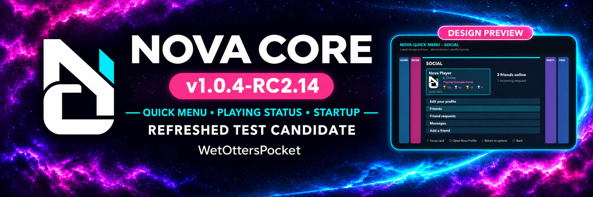

# 🎮 NovaCore v1.0.4-RC2.14 — Quick Menu, game status & startup

RC2.14 now includes the game-status, return-to-Nova and boot-artwork changes alongside its Quick Menu input fixes. Everything stays in **RC2.14**.

📦 **The refreshed PKG is ready locally; owner upload pending.** Use the matching checksum below and **helper 94422**. The earlier RC2.14 checksum/helper 94421 has been superseded. This is a test candidate: build and computer-side checks passed; the refreshed package has **not been tested on a PS4**.

## 🛠️ Added, changed and fixed

- 🎮 **Playing status:** the helper checks the running game independently of Nova's launch screen. It can recognise games opened from Nova or Sony's dashboard, using the Library's saved game names, and sends activity updates while Nova is in the background.
- 🟢 **Gamercard & friends:** the existing green Online light and pink Playing line use that activity. Closing the game clears it; updates retry if a request fails. Appear offline and game-sharing settings still apply.
- ⚡ **Return to Nova:** choosing Return in Quick Menu now tells Nova to clear a completed game's launch screen straight away, instead of relying on its old suspension/20-second timeout. This targets the long Launching… wait; actual return time needs your PS4 test.
- 🌌 **Boot artwork:** the logo/loading ring stays up for at least seven seconds, then waits for the current screen's queued artwork and dashboard readiness to settle. A timeout remains for missing artwork; this does not download the entire Library before opening.
- 🔘 **Quick Menu input:** retained focus and input protections target the problem where menu navigation also moved the game/dashboard underneath. Closing or a menu failure returns focus. **Game-side input isolation still needs console confirmation.**
- 🏎️ **Dashboard performance:** hidden Quick Menu updates now go idle after one final cleanup pass. Profile-picture scans are shared briefly instead of repeated by each panel, and idle game discovery is rate-limited. The aim is less dashboard work without changing the layout; actual smoothness still needs your console check.

The Quick Menu design, Social controls, Music and existing features stay in place. No game saves, user data or game databases were changed. No friend-service update is required for these changes.

*Generated desktop design preview with demonstration data, retained from RC2.13. It is not a screenshot proving the refreshed build on a console.*

## ✅ Retained from RC2.13

Friends, requests and messages in Social; trophy pictures/counts; gamercard focus controls; local music scanning/artwork; independent YouTube setup and Phone Link notifications. The local MP4 reader fix candidate is retained—**PS4 playback is still unconfirmed**.

## 📥 Install & test

GoldHEN is required. Keep your last working build and settings; do not update firmware for Nova.

1. Once the owner attaches it, download **RC2.14** and check it against the checksum below. Do not mix it with the earlier same-name candidate.
2. Install normally, **open Nova once**, then fully restart and enable GoldHEN so the updated helper loads. Check for **94422**.
3. On Sony's dashboard first, **hold touchpad** and try D-pad, sticks, L1/R1 and ✕. Only QM should respond. Close it and check normal controls return. Repeat from a safe game menu.
4. Open a game from Nova, then check your gamercard and a friend's view after Social refresh. Also check a Sony-launched game. Test Appear offline/sharing off, then close the game and check its activity clears.
5. **Hold touchpad → Return to Nova → ✕**. Time the return and check whether the long Launching… wait is gone. A normal PS-button tap still opens Sony's dashboard.
6. Cold-start Nova: check the loading ring stays animated and visible artwork is ready when the dashboard appears. Missing/offline artwork should not leave an endless loading screen.

## 🧪 Known issues & reporting

Console acceptance is pending. Game detection depends on the existing running-app query and Nova's Library catalogue; an unavailable game name may show its title ID. Social changes follow its refresh cycle. A short activity lease expires if the helper stops renewing it.

Playback, full HEN auto-start, USB-game compatibility, Store redirection and actual phone-notification delivery still need hardware checks. No guarantee is made that every game stops receiving input while QM is open. Stop on a crash/freeze; don't repeatedly trigger one just to get logs.

Report **build/helper, firmware, console model, GoldHEN, launch route and what happened**. Include return/boot timings, a photo and relevant `qm-overlay.log`, `game-launch.log` or boot log if available. Remove personal information. Never send tokens or private configuration.

## 🔎 Refreshed package

| Item | Value |
|---|---|
| File | `NovaCore-v1.0.4-RC2.14.pkg` |
| Size | `292,683,776 bytes` |
| Package version | `03.27` |
| Resident helper | `94422` |
| SHA-256 | `22d6b36057ffcbee667c29f0906dd954eebcf3052e0923c321322306aa8f2327` |

All **420 extracted files** checked. Helper built twice identically, with unchanged imports and no new warnings. Focus/input, Social navigation/privacy, activity publication, boot gating and return guards passed computer-side tests. These checks do not replace PS4 testing.

**Owner will attach the PKG.** Application/plugin source remains private during the RC; third-party components retain their licences. Previous local builds are retained for recovery; an older installer may not automatically downgrade a resident helper.

[Full dashboard features](https://github.com/WetOttersPocket/NovaCore/releases/tag/v1.0.4-RC2.13) · [Changelog](https://github.com/WetOttersPocket/NovaCore/blob/main/CHANGELOG.md) · [Known issues](https://github.com/WetOttersPocket/NovaCore/blob/main/KNOWN-ISSUES.md) · [Discord](https://discord.gg/cjgA8T94E)

NovaCore by **WetOttersPocket** 🦦
