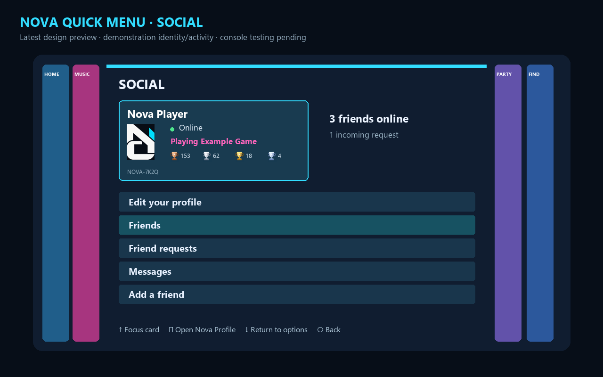

# 🎮 NovaCore v1.0.4-RC2.14 — Quick Menu, game status & startup

RC2.14 now includes the game-status, return-to-Nova and boot-artwork changes alongside its Quick Menu input fixes. Everything stays in **RC2.14**.

## 🛠️ Quick Menu opening hotfix — 23 November

Sorry for the extra download, everyone. The last update reduced dashboard lag, but it also stopped the Quick Menu and top-bar panels from opening on the reported console. Thanks for sticking with the testing and letting me know ❤️

- 🔘 Corrected the compatibility check that blocked the menu on firmware without certain menu-focus features.
- 🧭 Kept the opening controls active while skipping unnecessary hidden-menu redraws.
- 🏎️ Kept the lag reductions. The owner reported less dashboard lag and working game-hover panels in the previous build.
- 📦 Only the bundled helper changed. The Nova app, settings and other RC2.14 additions stay in place.

**Install over RC2.14 → open Nova once → fully restart PS4 → enable GoldHEN normally.** Then hold touchpad and check the dashboard Profile/Friends/Messages panels.

Build and computer-side checks passed. **Hotfix console confirmation is pending**, including game-input isolation. Check the game underneath stays still while using QM; close it and report if it responds.

📥 **[Download the corrected hotfix PKG](https://github.com/WetOttersPocket/NovaCore/releases/download/v1.0.4-RC2.14/NovaCore-v1.0.4-RC2.14-QM-HOTFIX-94424.pkg)** · helper **94424**. Choose **QM-HOTFIX-94424.pkg**; older RC2.14 packages are retained and superseded.

## 🛠️ Added, changed and fixed

- 🎮 **Playing status:** the helper checks the running game independently of Nova's launch screen. It can recognise games opened from Nova or Sony's dashboard, using the Library's saved game names, and sends activity updates while Nova is in the background.
- 🟢 **Gamercard & friends:** the existing green Online light and pink Playing line use that activity. Closing the game clears it; updates retry if a request fails. Appear offline and game-sharing settings still apply.
- ⚡ **Return to Nova:** choosing Return in Quick Menu now tells Nova to clear a completed game's launch screen straight away, instead of relying on its old suspension/20-second timeout. This targets the long Launching… wait; actual return time needs your PS4 test.
- 🌌 **Boot artwork:** the logo/loading ring stays up for at least seven seconds, then waits for the current screen's queued artwork and dashboard readiness to settle. A timeout remains for missing artwork; this does not download the entire Library before opening.
- 🔘 **Quick Menu input:** retained focus and input protections target the problem where menu navigation also moved the game/dashboard underneath. Closing or a menu failure returns focus. **Game-side input isolation still needs console confirmation.**
- 🏎️ **Dashboard performance:** hidden Quick Menu updates now go idle after one final cleanup pass. Profile-picture scans are shared briefly instead of repeated by each panel, and idle game discovery is rate-limited. The aim is less dashboard work without changing the layout; actual smoothness still needs your console check.

- 🎞️ **Experimental H.265/HEVC:** software decoding added up to 1080p SDR, with 8/10-bit input converted to 8-bit output. H.264 hardware-first/fallback retained; HDR/DRM/4K unsupported. HEVC playback/smoothness still needs PS4 testing. HTTPS MP4 now uses the codec-aware FFmpeg path.
- 💬 **Latest optional orbisRPC files:** official 1.1 ELF and Setup PKG bundled and hash-checked. Explicit preparation only; no automatic install/start/config replacement or account link. Full shared RPC wizard remains unfinished.
- 🕹️ **Simpler Library controls:** removes L3/R3 + Triangle shortcuts. Save the view from R3's game menu; choose your start page in Settings. Triangle keeps its normal page action.
- 🗂️ **Fix an item's category:** R3 → Library category cycles Automatic/Games/Apps/Classics and saves for this PS4 user. No game files or Sony databases changed.
- ❓ **Help & FAQ:** Settings → System & About now explains controls, categories, Phone Link, YouTube, the PC Discord bridge, RPC and reporting. Original orbisRPC logo and maintainer credits included.

*Desktop UI previews from the candidate layout/text with demonstration data. Not console-tested screenshots.*

The Quick Menu design, Social controls, Music and existing features stay in place. No game saves, user data or game databases were changed. No friend-service update is required for these changes.

*Generated desktop design preview with demonstration data, retained from RC2.13. It is not a screenshot proving the refreshed build on a console.*

## ✅ Retained from RC2.13

Friends, requests and messages in Social; trophy pictures/counts; gamercard focus controls; local music scanning/artwork; independent YouTube setup and Phone Link notifications. The local MP4 reader fix candidate is retained—**PS4 playback is still unconfirmed**.

## 📥 Install & test

GoldHEN is required. Keep your last working build and settings; do not update firmware for Nova.

1. Download **NovaCore-v1.0.4-RC2.14-QM-HOTFIX-94424.pkg** using the link above and check its matching checksum.
2. Install normally, **open Nova once**, then fully restart and enable GoldHEN so the updated helper loads. Check for **94424**.
3. On Sony's dashboard first, **hold touchpad** and try D-pad, sticks, L1/R1 and ✕. Only QM should respond. Close it and check normal controls return. Repeat from a safe game menu.
4. Open a game from Nova, then check your gamercard and a friend's view after Social refresh. Also check a Sony-launched game. Test Appear offline/sharing off, then close the game and check its activity clears.
5. **Hold touchpad → Return to Nova → ✕**. Time the return and check whether the long Launching… wait is gone. A normal PS-button tap still opens Sony's dashboard.
6. Cold-start Nova: check the loading ring stays animated and visible artwork is ready when the dashboard appears. Missing/offline artwork should not leave an endless loading screen.

## 🧪 Known issues & reporting

Console acceptance is pending. Game detection depends on the existing running-app query and Nova's Library catalogue; an unavailable game name may show its title ID. Social changes follow its refresh cycle. A short activity lease expires if the helper stops renewing it.

Playback, full HEN auto-start, USB-game compatibility, Store redirection and actual phone-notification delivery still need hardware checks. No guarantee is made that every game stops receiving input while QM is open. Stop on a crash/freeze; don't repeatedly trigger one just to get logs.

Report **build/helper, firmware, console model, GoldHEN, launch route and what happened**. Include return/boot timings, a photo and relevant `qm-overlay.log`, `game-launch.log` or boot log if available. Remove personal information. Never send tokens or private configuration.

## 🔎 Refreshed package

| Item | Value |
|---|---|
| File | `NovaCore-v1.0.4-RC2.14-QM-HOTFIX-94424.pkg` |
| Size | `308,412,416 bytes` |
| Package version | `03.27` |
| Resident helper | `94424` |
| SHA-256 | `2880de4fec6dd5280608f98af7bb5ec4c408f87b3f09933c65c7fbedbbc159e2` |

Hotfix package validated; **427 extracted payload files** compared. Only the bundled helper changed from the previous RC2.14 package. Helper built twice identically, with unchanged imports and no new warnings. Focus/input, Social navigation/privacy, activity publication, boot gating and return guards passed computer-side tests. These checks do not replace PS4 testing.

**The corrected hotfix PKG is attached.** Application/plugin source remains private during the RC; third-party components retain their licences. Previous local builds are retained for recovery; an older installer may not automatically downgrade a resident helper.

[Full dashboard features](https://github.com/WetOttersPocket/NovaCore/releases/tag/v1.0.4-RC2.13) · [Changelog](https://github.com/WetOttersPocket/NovaCore/blob/main/CHANGELOG.md) · [Known issues](https://github.com/WetOttersPocket/NovaCore/blob/main/KNOWN-ISSUES.md) · [Discord](https://discord.gg/cjgA8T94E)

NovaCore by **WetOttersPocket** 🦦

[Help & FAQ](https://github.com/WetOttersPocket/NovaCore/blob/main/docs/HELP-FAQ.md) · [Optional RPC guide and credits](https://github.com/WetOttersPocket/NovaCore/blob/main/docs/ORBISRPC-SETUP.md). The requested shared Nova/ShellUI RPC token-transfer wizard is **not implemented**; no token collection or automatic RPC authorisation has been added.
