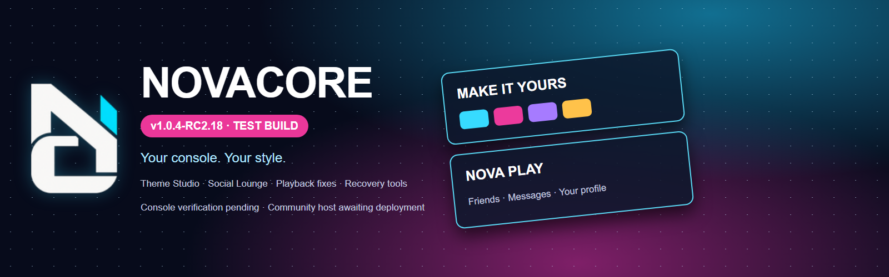
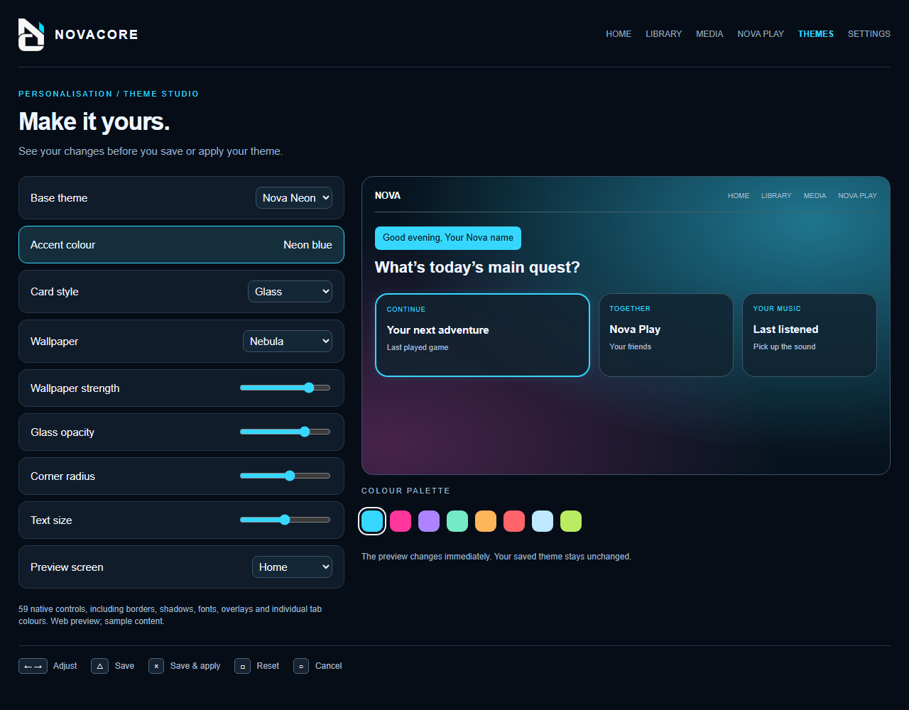
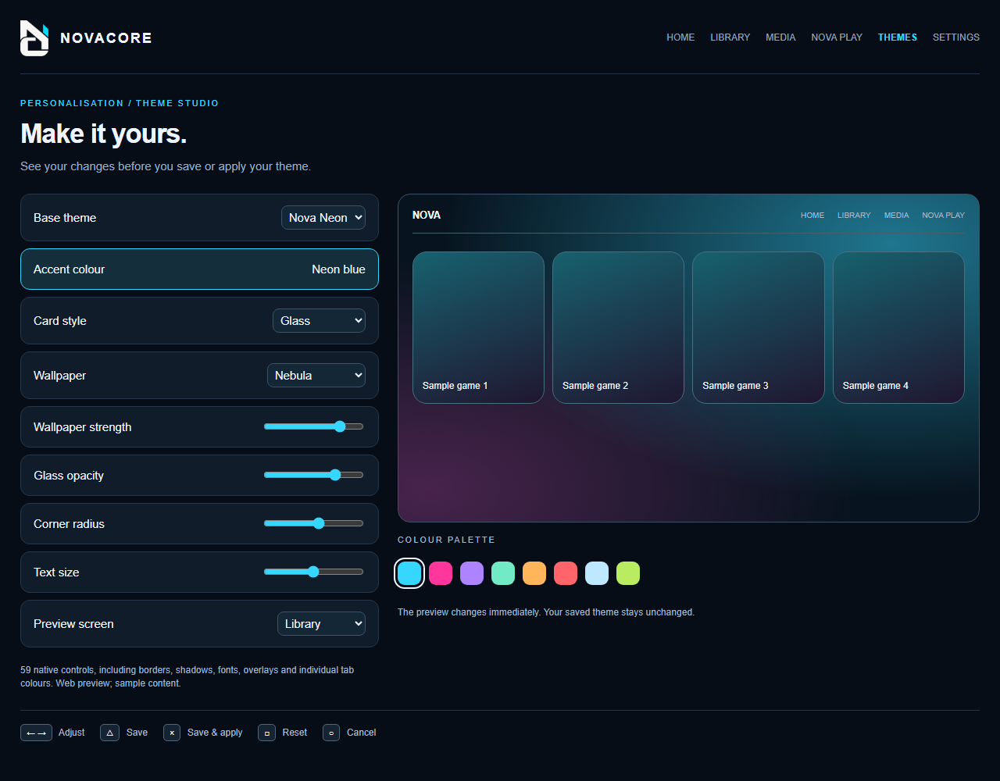
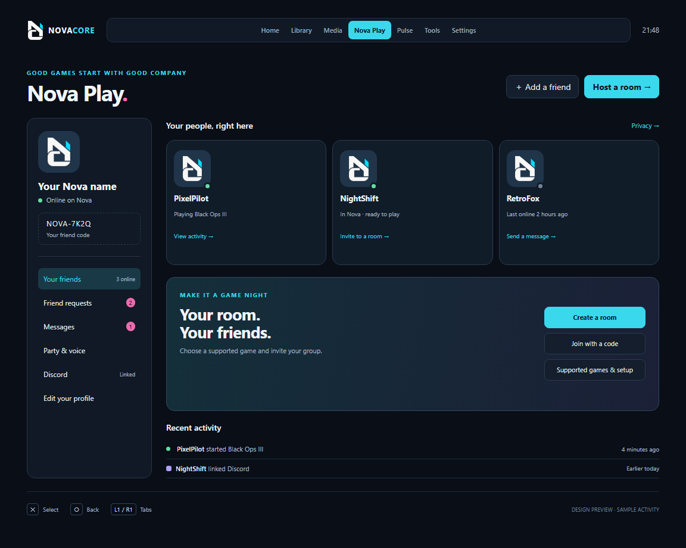
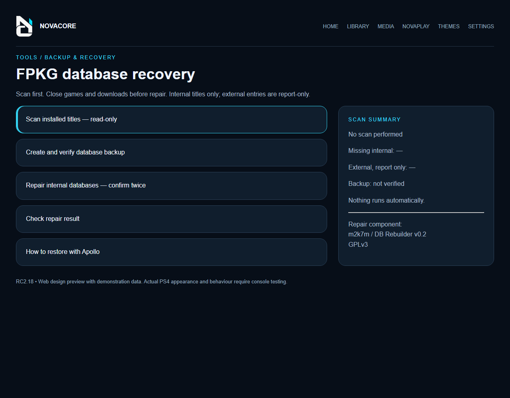

# NovaCore v1.0.4-RC2.18 🦦

**Theme Studio, Social Lounge, playback fixes and manual database recovery.** Combines the private RC2.15–RC2.17 work with RC2.18. Nova's app source stays private.

📦 **[Download the PKG](https://github.com/WetOttersPocket/NovaCore/releases/download/v1.0.4-RC2.18/NovaCore-v1.0.4-RC2.18.pkg)** · [Complete feature overview](README.md) · [Known issues](KNOWN-ISSUES.md)

**Test pre-release:** build and host checks passed; these changes have not been verified on a PS4. The console was left in rest mode. Community Themes hosting and the revised server name-change allowance are prepared but not deployed.

## 🎨 Make Nova yours

- Theme Store starts with **＋ Make your own theme**.
- **59 editor rows:** base theme, wallpaper, accents, text/canvas/glass colours, opacity, card style/size/radius, borders, outlines, shadows, focus glow, comic dots, fonts, labels, greeting/quote tags, wallpaper strength/saturation/zoom/vignette/glow, moving overlays, sounds, appearance choices, individual section/tab colours and theme details.
- Visible palettes and **Home / Library / Quick Menu samples** show changes before saving. The QM sample is illustrative; it does not replace or restyle the resident menu.
- Choose a wallpaper from storage, name your theme, update your own theme or save a separate copy. Built-in themes remain intact. Global mute and other safety choices still take precedence.
- Expanded moving overlays, original Arcade/Toon sounds and a bundled Bebas Neue headline font with its licence.
- Refreshed theme/wallpaper browsing and radio page carried forward from the private builds.
- **Community Themes** catalogue, previews, separate-copy installation and opt-in public upload are prepared. **The host is not live yet.** Local saving is independent; upload can fail until deployment. Current host limits: 20 immutable uploads per owner, no self-service withdrawal yet. Do not upload private content or artwork you cannot share.
- Layout order: **Nova Dashboard → Nova Lab → Nova Series → Nova Switch**, then remaining layouts. Saved layout IDs are preserved.




## 👥 Social Lounge and identity

- **Nova Play returns to the main tabs.** Social Lounge brings your profile, friends, requests, messages, room actions and Discord access together. Existing Friends screens open within Nova Play, with Back returning to the lounge.
- Shared request-alert tracking targets repeated popups between Nova and the helper. Privacy settings remain respected.
- Friend avatars and relative last-online labels, with a Nova fallback when no picture is shared.
- Revised current-game lookup and bounded catalogue matching. **Actual game activity still needs PS4 confirmation.** Appear offline or sharing-off must hide activity.
- Consistent Nova display names in the app/header, gamercard and cosmetic Sony label. **This does not change PSN Online ID, accounts, activation or saves.** Console results are unverified; native Sony picture writing stays disabled.
- QM keyboard adds **CAPS / abc**, with L2 case toggle.
- Client explains **two name changes per rolling 60 days**. The matching server patch is staged, not deployed; live server rules remain authoritative until updated.



## 🎮 PS dashboard and Quick Menu

- Top-bar fixes use the current icon's focus and reject stale game-tile focus. Profile/Friends/Messages retain their own panel presentation; **icons do not display the touchpad QM**.
- Existing QM, input isolation, closing/drain handling and crash safeguards retained. No new menu or hook architecture.
- **Hold touchpad about half a second** to open QM in Nova, on Sony's dashboard or over games when the helper is active. Choose **Return to Nova → ✕**. A normal PS-button press still opens Sony's dashboard.
- Bundled helper **94429** has baseline-identical imports and reproducible builds. Host checks do not establish firmware/controller compatibility.

## 🎬 Playback fixes

- YouTube and companion tracks use software H.264, targeting the reported crashes.
- Two-failure guard now recognises the corrected player version. Old hardware-player failures do not silently block it; two failures on the new path still stop repeated attempts.
- Disabled console resolver reports its real error instead of silently falling back to a server error.
- Decoder backpressure retries the same packet; normal H.264 filtering is restored, targeting pixelation. Repeated decoder errors stop with an error.
- Includes private local/USB software decoding changes. **YouTube, local MP4/MKV and USB playback still need console tests.** Container names and stream addresses do not guarantee playback.
- Experimental software HEVC remains CPU-limited; start at 720p SDR. No 4K, HDR or DRM promises.

## 💾 Manual FPKG database recovery

**Tools → FPKG database recovery:** read-only scan, verified app/DLC database backup, explicit repair confirmation and upstream result checking.

- **Never runs on install, boot or entering the page.** Repair needs a fresh scan and verified backup for the current user. Changed databases, active WAL or damaged backup block repair.
- Close games, installs and downloads first. Enable GoldHEN BinLoader on port 9090. Press ✕ twice on repair. It changes application/DLC databases through the separately bundled tool; keep your backup.
- Uses **m2k7m's unmodified DB Rebuilder v0.2**, pinned by hash, as a separate payload. Internal titles visible under `/user/app` are targeted. Missing external-only entries are **report-only**. This cannot guarantee repair of USB registration, damaged content or a failing drive.
- Delivery is not reported as repair success. Choose **Check repair result**; inspect `/data/DB-Rebuilder/DB-Rebuilder.log` for uncertain results. A ten-minute dispatch guard limits repeats.
- Backups: `/data/novacore-lab/db-recovery/backup-…/`, including `database.zip` and hashes. For manual restore, copy the ZIP to `/data/apollo/export/db/`, then use Apollo **User Tools → App.db Database Management → Restore**. Nova does not restore over a live database. Restart manually after a successful repair/restore.
- Upstream GPLv3 licence and corresponding source are bundled separately. That archive contains only DB Rebuilder, not Nova app or ShellUI source. **Recovery has not been run or verified on a console.**



## 📺 Usability

- Ordinary bottom notices last about **2.5 seconds**, suppress identical recent repeats and draw once.
- Native content respects the existing TV safe area; wallpaper stays full bleed. Sony resident panels need a separate TV check.
- Earlier packages retained locally; existing settings and user content were not deleted.

## 📦 Install or update

1. Keep your known-good PKG/settings. Download above and compare SHA-256 with `SHA256SUMS.txt`.
2. Install over **NOVA00003** with your normal GoldHEN package installer. Open Nova once to stage the bundled helper. Do not hot-load a second helper over the running one.
3. **Fully restart**, then enable GoldHEN normally. Existing Nova AutoRun should use its usual route; otherwise open Nova yourself.
4. Test touchpad QM on Sony's dashboard before gameplay. Then test game launch, QM return, top-bar panels and playback. Stop after a freeze; do not repeatedly crash for logs.

An older PKG may not downgrade a higher-numbered installed helper. Restore your backed-up helper only while it is unloaded, then restart. Avoid mixing helpers.

## 🧪 Test and report

Include build, firmware, exact GoldHEN version, internal/USB location, steps and result. Playback: `video.log` and boot log. Launch: `game-launch.log`, boot log and crash-native log if present. Never share tokens, account files, private stream URLs or pairing codes.

Check theme save/reopen/cancel, wallpaper import, layout order, sample scenes, palette/borders, Social Back, requests, privacy/activity, top-bar closing, QM input isolation, YouTube and a known-good local film. **Do not repair a healthy database merely for testing.** Community upload waits for host deployment.

## Verification and remaining work

- Native compile/link and SELF layout/guard passed; PKG validated and **437 extracted files verified**.
- Seven focused host suites passed, including 23 decoder/routing assertions. Recovery: 17 assertions and ZIP CRC/file/byte checks on synthetic databases.
- Actual helper input/scene tests, 40 Social navigation checks, 14 Back/Close/lease checks and activity/privacy cases passed. Helper reproducibility/import checks passed.
- Community server: **13 tests passed**, not deployed.
- Protected PS-button plugin and existing payloads unchanged. **No console verification or server deployment claimed.**
- Optional orbisRPC 1.1 files/credits retained. Automatic RPC setup wizard remains unfinished; no Discord account-token collection added.

All pictures are **web-produced design previews**, not PS4 screenshots. [Third-party credits](THIRD-PARTY-NOTICES.md).

**PKG SHA-256**
```
8f95d77951e25a4976590822f901f0e34a053aca9fe4133784dea298e52409e8
```
