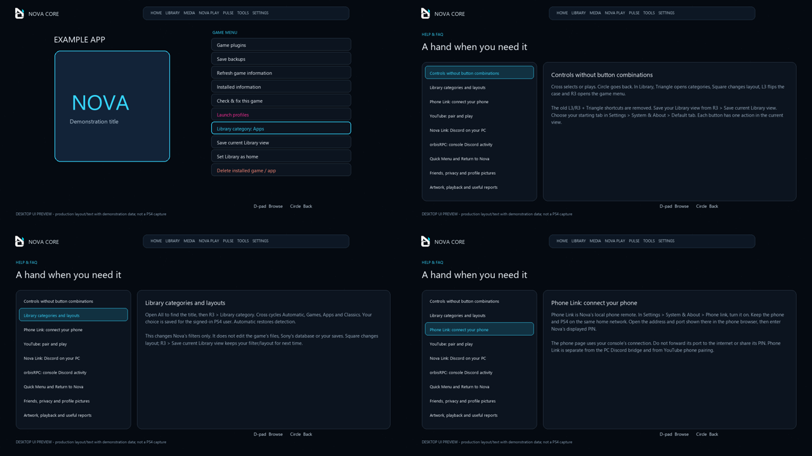

# NovaCore Help & FAQ

## What are the Library buttons?

✕ plays/selects, ○ goes back, △ opens categories, □ changes layout, L3 flips the case and R3 opens the game menu. The new candidate removes the overlapping L3/R3 + Triangle shortcuts. Use **R3 → Save current Library view** instead. Choose a starting page through **Settings → System & About → Default tab**.

## An app appears under Games. Can I fix it?

Find it under All, open R3 → Library category, then press ✕ to cycle **Automatic → Games → Apps → Classics**. The choice saves for your signed-in PS4 user and survives a restart. Automatic restores detection. These are Nova-only categories; no game metadata, Sony database or saves are edited.

## Where is the in-app guide?

**Settings → System & About → Help & FAQ.** Browse its topics with Up/Down; Circle returns to Settings. Desktop previews below show the candidate; console testing is pending.

## Phone Link, Nova Link and YouTube pairing—what is the difference?

- **Phone Link:** Nova's local phone remote. Enable Phone link in System & About; put both devices on the same home network, open the console address/port shown and enter its PIN. Keep this private; do not open the port to the internet.
- **Nova Link PC bridge:** runs with Discord desktop on your PC for that Rich Presence route. It must stay running; it is not the same as the local phone page.
- **YouTube pairing:** use Media → YouTube → phone pairing → New code. Scan the QR or use the address/code shown, then approve your own PS4. It does not require setting up Friends/Nova Online first. Phone notifications require permission; iPhone may need Add to Home Screen.
- **Discord identity linking:** Nova's official QR link adds your Discord identity to Nova Friends. It does not provide the separate account-session credential required by orbisRPC.

## Can Nova play HEVC/H.265?

This updated candidate adds experimental software HEVC/H.265 decoding up to 1080p SDR, including 8/10-bit input converted to 8-bit output. It does not use PS4 hardware HEVC decoding. Smoothness and actual playback still need console testing, so start with a short 720p sample. HDR, DRM and4K remain unsupported. H.264 retains its hardware-first/software-fallback route. HTTPS MP4 now uses the codec-aware FFmpeg path too. Jellyfin transcoding remains useful for demanding files. MP4/MKV are containers, not codec guarantees. A console-local hevc.off switch can disable only this experiment.

## How do I get back from a game?

Hold touchpad → Return to Nova → ✕. A normal PS tap opens Sony's dashboard. If Quick Menu navigation moves the game underneath, close it and report the build/helper and controls; test only from a safe game menu.

## How do I report a problem?

Send Nova build/helper, firmware, GoldHEN, console model, exact action and error, plus a photo/log if available. Strip private details. Never send Discord tokens or RPC configuration, and do not repeatedly reproduce a freeze just for logs.

*Desktop UI previews using production layout/text and demonstration data; not console captures.*
