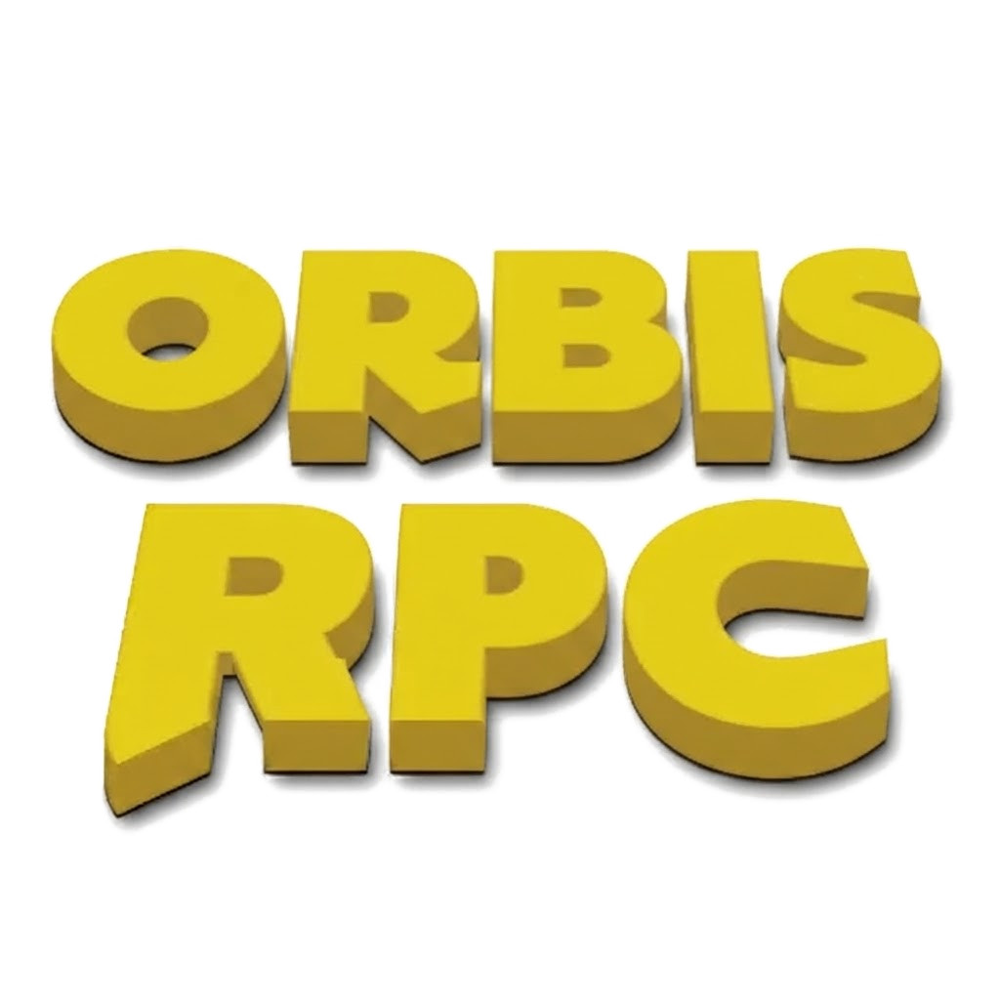

# Optional orbisRPC setup

**orbisRPC by SirHumza, CyberMask367 and contributors.** Nova provides an optional entry point; the payload and its logo belong to the upstream project. [Official project](https://github.com/SirHumza/orbisRPC) · [Latest release](https://github.com/SirHumza/orbisRPC/releases) · [Upstream security notes](https://github.com/SirHumza/orbisRPC/blob/main/SECURITY.md).

## Read this first

orbisRPC uses a Discord **account-session token**, which can grant account access. Discord restricts automation of normal user accounts; account checks or credential invalidation are possible. It is optional. Cancel if you are not comfortable with that method.

Nova's normal Discord QR authorisation is separate and cannot supply this credential. Never send a token, its screenshot or `config.json` to a bot, support channel, developer or another person.

**Current build truth:** Nova can prepare its bundled optional ELF and open an installed setup app. The requested shared Nova/ShellUI RPC wizard and private phone token-transfer controls are not finished. The steps below describe upstream's current setup, not a one-click Nova integration. Nova now bundles the official 1.1 ELF and matching1.1 Setup PKG, checked on 23 November against GitHub asset digests. Prepare optional RPC 1.1 files verifies them again, places the versioned ELF in Nova's optional-rpc folder and makes the Setup PKG available in /data/pkg for manual installation. It does not replace a resident payload, change its config, install, autorun or link it. Old bundled files are retained but the active preparation action selects 1.1.

## 1. Choose and install upstream Setup

Use the **latest official orbisRPC Setup PKG** from the release page above. Enable GoldHEN and install it through your normal package installer, then open orbisRPC Setup. Review the chosen version's instructions before replacing an existing running payload. Do not install multiple RPC copies or automatically replace a live ELF.

In Setup choose **INSTALL / UPDATE** and follow its prompts. It provides the payload and configuration; do not overwrite your whole configuration with a sample. Autorun is optional: leave it off while first testing. Upstream also offers a standalone ELF route; use its matching release guide rather than mixing version instructions. [Installer reference](https://github.com/SirHumza/orbisRPC/blob/main/docs/INSTALLER.md).

## 2. Obtain only your own account token privately

On your own PC/Mac, sign into your own Discord account in a browser. Open Developer Tools (usually F12), select Console and check that the page context is **top**, not a worker. Upstream's current token guide uses this one local clipboard command:

```js
copy(localStorage.token)
```

It reads that browser page's stored value; it does not send it to Nova. Do not paste arbitrary token-finding scripts or disable browser protections to run unknown code. If the value is missing, `undefined` or inaccessible, stop and consult the upstream guide—do not use a third-party token service. This method may change with Discord/browser updates. [Upstream token guide](https://github.com/SirHumza/orbisRPC/blob/main/docs/TOKEN_SETUP.md).

## 3. Configure the console privately

Use orbisRPC Setup's token entry/settings flow. If you choose its documented manual configuration route, edit only the `token` value in your own console's `/data/orbisRPC/config.json`, preserving every other field and valid JSON. Protect any computer copy as a credential; it must not go into synced storage, logs or support archives. This manual route involves your browser/clipboard and potentially a computer copy, so we do **not** call it console-only custody.

Nova Link does not yet provide a token-paste/transfer button. Do not paste an account token into its search, message, pairing-code or URL fields. Clear your clipboard and any clipboard-history entry once finished. [Configuration reference](https://github.com/SirHumza/orbisRPC/blob/main/docs/CONFIG.md).

## 4. Start and check

Start the payload once using the loader recommended for that exact upstream release. Launch a game and check your Discord profile after its update interval. A copied ELF or saved setting is not proof of a running/connected RPC session. If authentication is refused, stop/review the upstream troubleshooting guide; do not repeatedly submit a rejected credential or send it to support.

Only after a successful manual test should you opt into GoldHEN autorun. Restart as directed by upstream so a second instance is not loaded beside a resident copy. The newer 1.1 README recommends the standalone ELF for a straightforward setup; use the current release notes if they differ from an older guide.

## 5. Switch off or remove it

Disable orbisRPC's autorun entry in GoldHEN and fully restart to ensure that resident copy stops. Removing Nova's Discord identity link alone does not stop orbisRPC. Upstream Setup's **UNINSTALL** removes its payload/configuration; review its prompts because this removes RPC preferences too. Removing a file while its daemon is running does not prove its in-memory credential has been cleared. If a token was exposed, use Discord's account-security controls rather than merely deleting a local copy.

The future shared wizard needs separate, verified **Disconnect** and **Remove saved token** actions. Those Nova actions are not advertised as available yet.

## Credits and provenance

Original unmodified logo from `SirHumza/orbisRPC`, reviewed at commit `c04c5874631d94a939d92d591a4aa1881c48ea63`. Maintainers: SirHumza and CyberMask367, with community testing/metadata contributions. Nova integration and original guide text: WetOttersPocket/NovaCore. No Discord endorsement is implied. Upstream's repository does not currently declare a settled project licence; Nova does not relicense their work.
